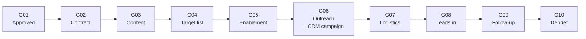

# Event Program OS: run 30+ events a year without losing the thread

> **Outcome:** every event has one ID, one folder, one CRM campaign and ten gates. Its status updates itself from evidence, so "is this event ready?" has a factual answer rather than an opinion.

A [Claude skill](https://docs.claude.com/en/docs/agents-and-tools/agent-skills/overview) that encodes how I run a B2B event program end to end. It's the backbone the rest of my toolkit plugs into.

---

## The problem

Event programs rarely fail on a single event. They fail in the gaps between events: contracts filed as "Agreement_final_v2.pdf," leads that never reached a CRM campaign, a debrief nobody wrote, and a tracker that grew so many fields that everyone stopped trusting it.

## The ten gates



Nobody marks an event "ready." People complete gates by linking evidence, and the status moves on its own. An `Evidence Gaps` check flags any gate that's ticked with nothing behind it.

## Design choices, and the reasons behind them

| Rule | Why |
|---|---|
| **Follow-up (G09) comes before the debrief (G10)** | Follow-up loses value fast. If the order is reversed, a tidy write-up starts standing in for actually contacting anyone. |
| **G09 counts any channel, not just "emails sent"** | A gate named after one channel is wrong the first time a rep follows up by phone. |
| **Create the CRM campaign at outreach, not after the event** | Otherwise the T+90 pipeline read has to be reconciled by hand. |
| **Event IDs are never reused** | A recycled ID quietly points old contracts and campaigns at the wrong event. |
| **Nothing new goes into the tracker unless something comes out** | Fields that people type but nothing reads are pure cost, and they make the board less trustworthy. |
| **No intake inside 8 weeks** | An event approved 30 days out clears its gates on paper and produces no pipeline. |
| **Score at intake, before money is committed** | An event scored after the fact is an event already decided. |
| **Outcome numbers are structured fields, not just prose** | Numbers written only in a document can't feed next year's scoring. |

## File naming that survives a year of events

```
EVT-024 Finance Leaders Summit — 2026-11-12/
├── EVT-024_PROPOSAL_FinLeaders.pdf
├── EVT-024_CONTRACT_FinLeaders.pdf
├── EVT-024_TARGETS_FinLeaders.xlsx
├── EVT-024_OUTREACH_Wave2_2026-09-14.docx
├── EVT-024_LEADS_FinLeaders.csv
├── EVT-024_LEADS_PRIOR-2025-11_FinLeaders.csv
└── EVT-024_DEBRIEF_FinLeaders
```

The ID always comes first, the type comes from a fixed list of words, there's no "final" or "v2," and the ID also appears on the top line inside each document.

## What's in the repo

| Path | What it is |
|---|---|
| `SKILL.md` | The operating system: systems, gates, naming, intake, verdicts, program patterns |
| `config.md` | Your commercial assumptions, ICP, systems and approval thresholds (example values) |
| `templates/tracker-schema.md` | A starter events-database schema: typed fields, formulas, gates, outcomes |

## Use it

Add it to your Claude skills alongside [event-vetting](https://github.com/parker-lauren/event-vetting) and [event-debrief](https://github.com/parker-lauren/event-debrief), fill in `config.md`, and ask things like *"Add the Finance Leaders Summit as a new event"* or *"What's blocking EVT-024?"*

---

*Part of my [event ops toolkit](https://github.com/parker-lauren): **run the program** → [vet the event](https://github.com/parker-lauren/event-vetting) → [enrich the leads](https://github.com/parker-lauren/webinar-lead-enrichment) → [clean the list](https://github.com/parker-lauren/event-contact-list) → [debrief honestly](https://github.com/parker-lauren/event-debrief). All names and figures here are illustrative.*
